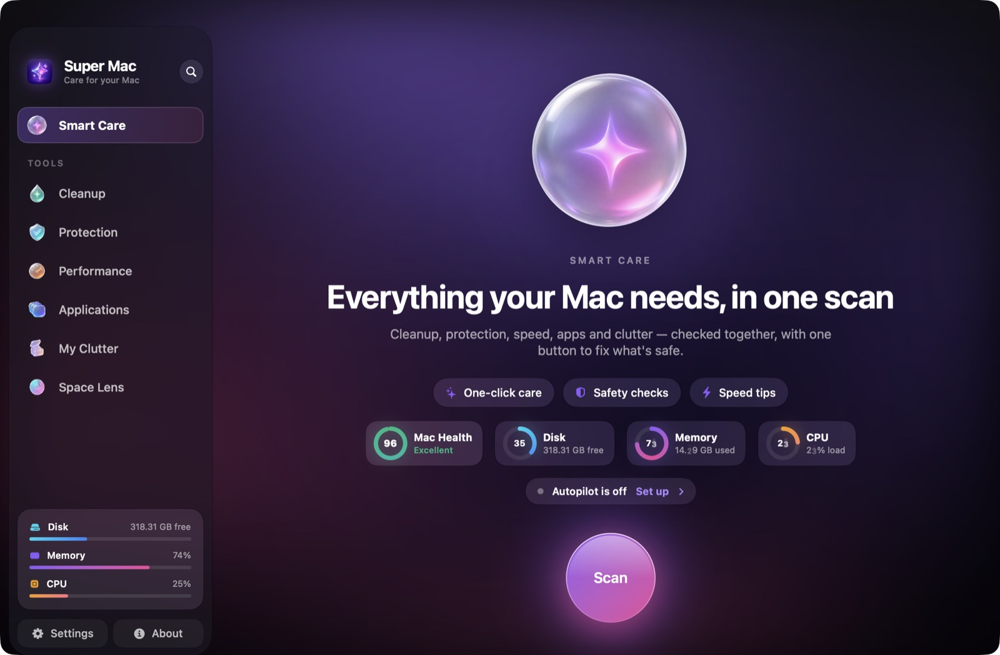
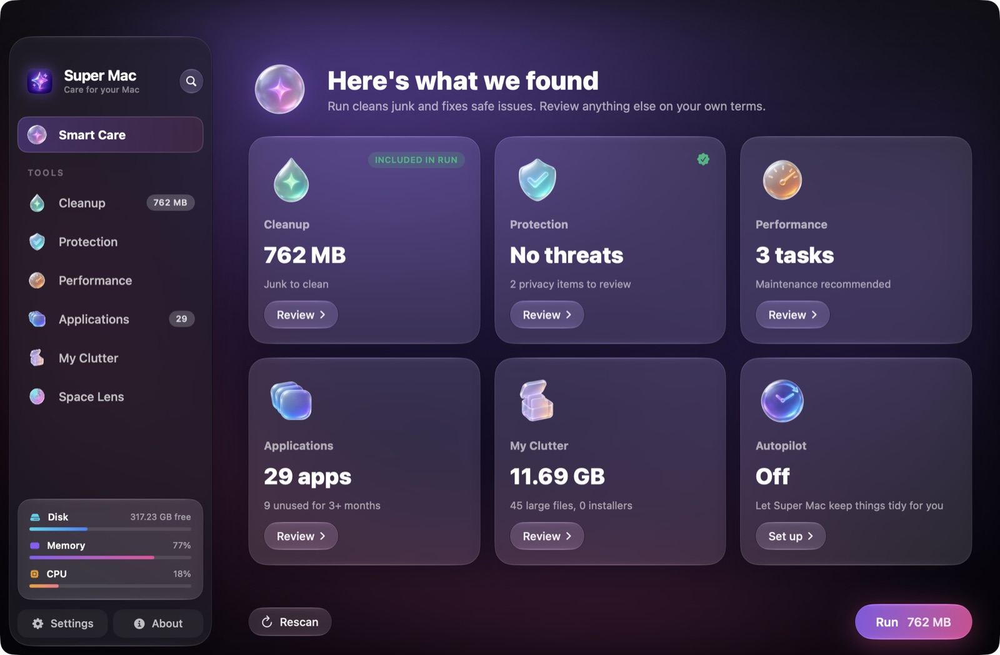
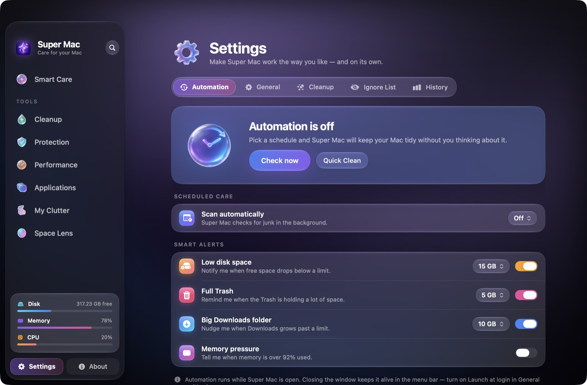
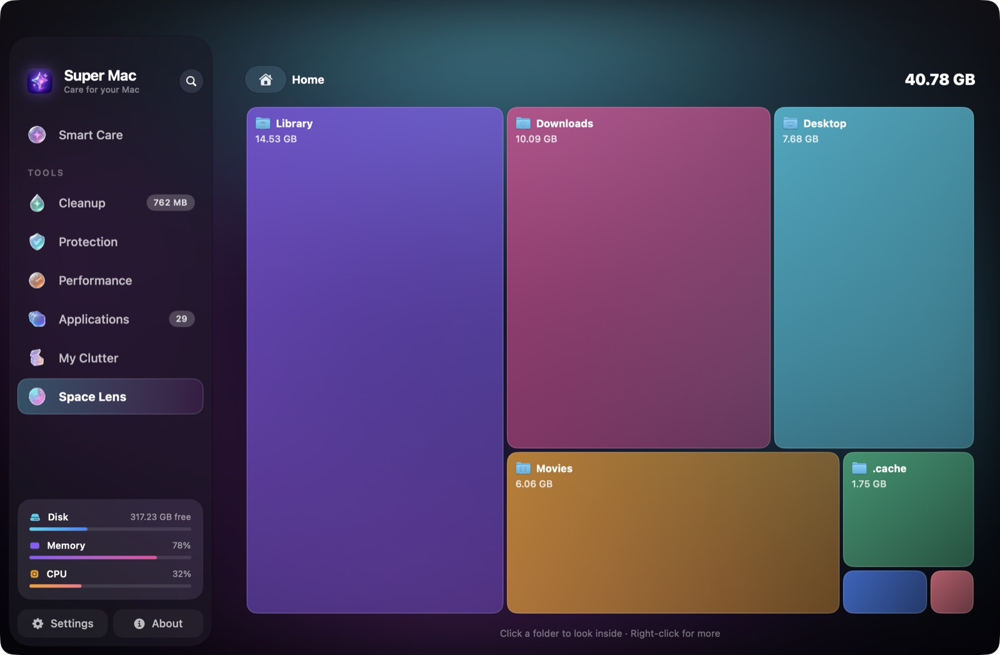
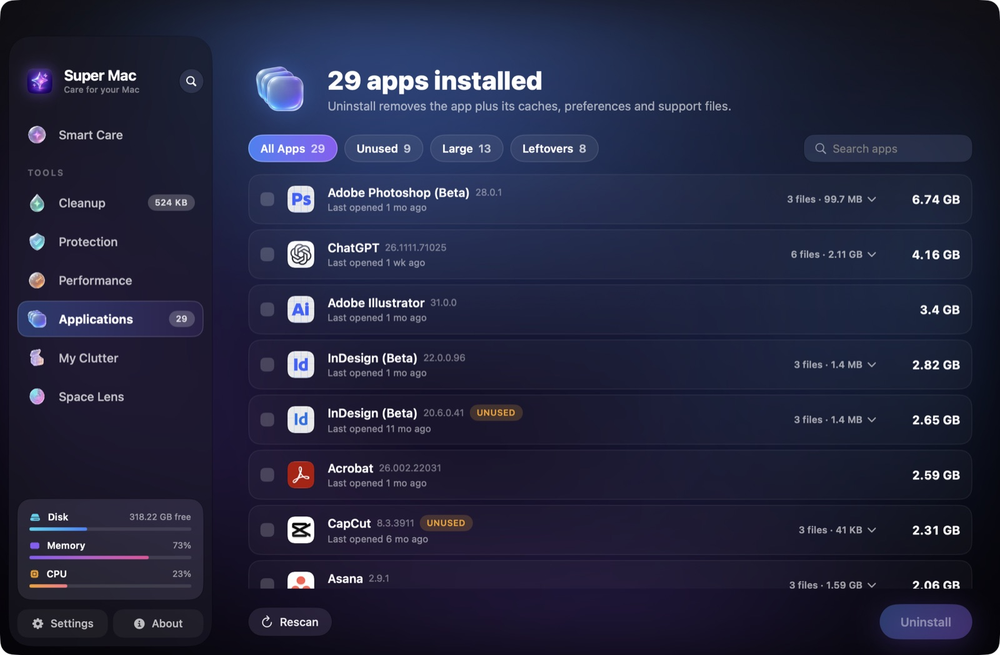
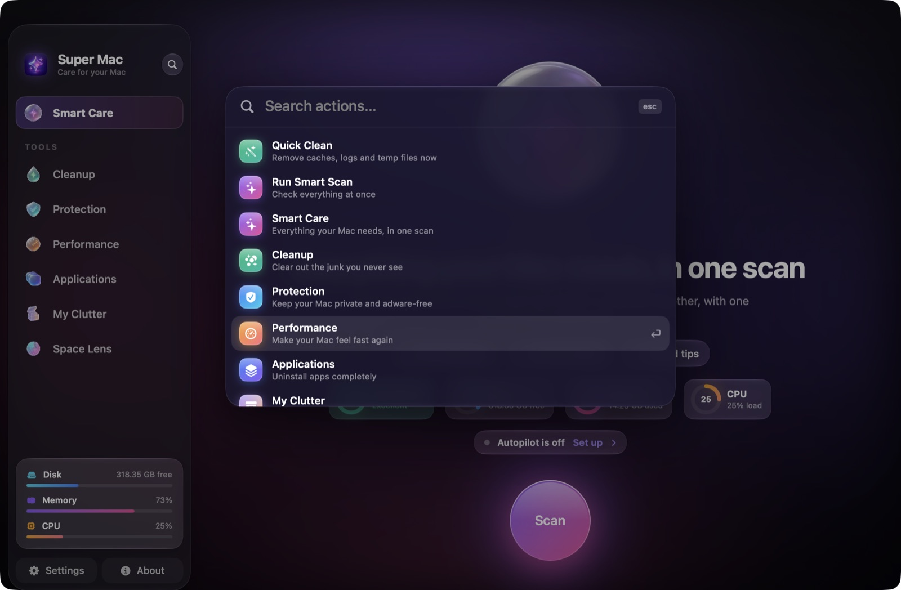
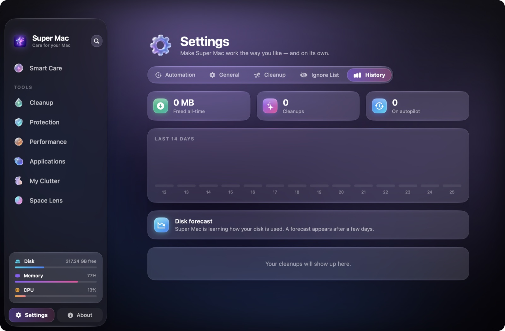
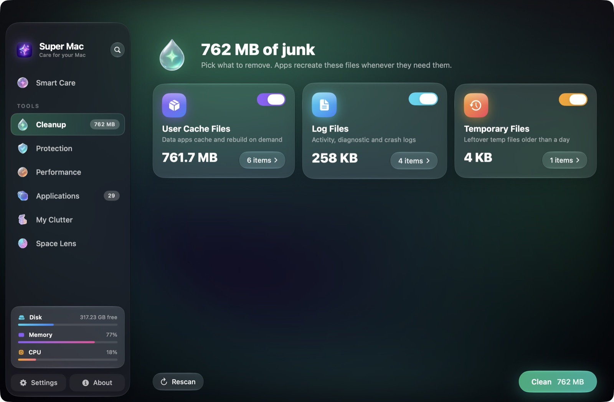

<p align="center">
  
</p>

<h1 align="center">Super Mac</h1>

<p align="center">
  <b>A free, private Mac cleaner with a dark Liquid Glass UI.</b><br>
  Cleanup · Protection · Performance · Uninstaller · Clutter finder · Space Lens · Autopilot
</p>

<p align="center">
  <a href="https://github.com/amirmhmdart/super-mac/releases/latest"></a>
  
  
  
  
</p>

<p align="center">
  
</p>

---

## Download

**[⬇ Download Super Mac v0.9 beta (.dmg)](https://github.com/amirmhmdart/super-mac/releases/latest)**

1. Open the DMG and drag **Super Mac** to **Applications**.
2. Open it. The first time, macOS says it can't verify the developer (the app isn't from the App Store).
   Go to **System Settings → Privacy & Security** and click **Open Anyway**. You only do this once.

Requires macOS 14 Sonoma or newer. One universal app for Apple Silicon and Intel.

## What it does

| | |
|---|---|
| **Smart Care** | One scan checks junk, privacy, performance, apps and clutter together. One button fixes what's safe. |
| **Cleanup** | User caches, logs, temp files, saved app states, Xcode/npm junk, old iOS updates and the Trash. |
| **Protection** | Checks launch agents against known adware and clears browser history, cookies and recent-items lists. |
| **Performance** | Free up RAM, flush DNS, rebuild Spotlight and Quick Look, manage login items, spot memory-hungry apps. |
| **Applications** | Uninstall apps together with their support files, caches and preferences. Finds leftovers from apps you already deleted. |
| **My Clutter** | Large & old files, duplicate copies and forgotten installers in Downloads. |
| **Space Lens** | An interactive treemap of your disk. Click into folders to find what's huge. |
| **Autopilot** *(new)* | Scheduled scans (daily / weekly / monthly), optional automatic cleanup of safe junk, and smart alerts for low disk space, a full Trash, a big Downloads folder and memory pressure. Catches up after sleep. |
| **Mac Health** *(new)* | A live 0–100 score from disk, memory, junk, threats and Trash, with what's pulling it down. |
| **Command Palette** *(new)* | Press ⌘K, type, hit Return. Every action without leaving the keyboard. |
| **Disk Forecast** *(new)* | Learns how fast your disk fills and tells you roughly how many days you have left. |
| **History** *(new)* | Every cleanup is logged, with a 14-day chart and an all-time total. |
| **Ignore List** *(new)* | Folders Super Mac will never touch. |

<p align="center">
  
  
  
  
  
  
  
  
</p>

## Safe by design

- **Nothing leaves your Mac.** No account, no analytics, no ads. The only network call is the optional "Check for updates", which reads this repo's latest release.
- **Your files go to the Trash first.** Clutter, Applications and Space Lens never delete permanently, so you can always put things back.
- **Junk is deleted only inside known junk folders** (`~/Library/Caches`, `~/Library/Logs`, temp…). Apple's own caches and caches of running apps are skipped.
- **Autopilot only touches caches, logs, temp files and saved app states.** Never your documents, never the Trash.
- **Admin tasks use macOS's own password dialog.** Super Mac never sees your password.

Honest limits for this beta: Protection is an adware check, not a full antivirus. Safari data and the Trash need Full Disk Access. The app is signed ad-hoc and not notarized yet, hence the one-time "Open Anyway".

## Keyboard shortcuts

| Shortcut | Action |
|---|---|
| ⌘K | Command Palette |
| ⌘1 – ⌘7 | Jump to a module |
| ⌘8 | Autopilot |
| ⌘9 | History |
| ⌘, | Settings |

## Build from source

No Xcode project needed, just the Command Line Tools:

```bash
xcode-select --install          # once
./build.sh                      # builds build/SuperMac.app (universal)
./tools/make_dmg.sh             # packages dist/SuperMac-<version>-beta.dmg
./tools/shots.sh                # renders screenshots into shots/
```

```
Sources/
  App.swift            window, sidebar, menu bar extra, shortcuts
  Theme.swift          colors, Liquid Glass modifiers, buttons, animated background
  Components.swift     shared screens (landing, scanning, working, done)
  Screens.swift        every module's UI
  Models.swift         scanners and models for each module
  Prefs.swift          settings, history, Autopilot scheduler, notifications, update check
  SettingsAbout.swift  Settings and About pages
  Core.swift           file system, shell and live system stats helpers
art/                   3D glass illustrations
assets/                About page photo and brand glyphs
```

Built with SwiftUI. Liquid Glass on macOS 26, with a material fallback on macOS 14–15.

## Made by


**Amir Mohamed**, designer & developer.
Ideas, bugs or just saying hi, all welcome.

[Facebook](https://www.facebook.com/AmirMohamedArtX/) · [Instagram](https://www.instagram.com/amirmhmdart/) · [LinkedIn](https://www.linkedin.com/in/amirmhmdart/) · [Email](mailto:amirmhmdart@gmail.com)

<br clear="left">

---

Released under the [MIT License](LICENSE). Not affiliated with Apple or MacPaw.
